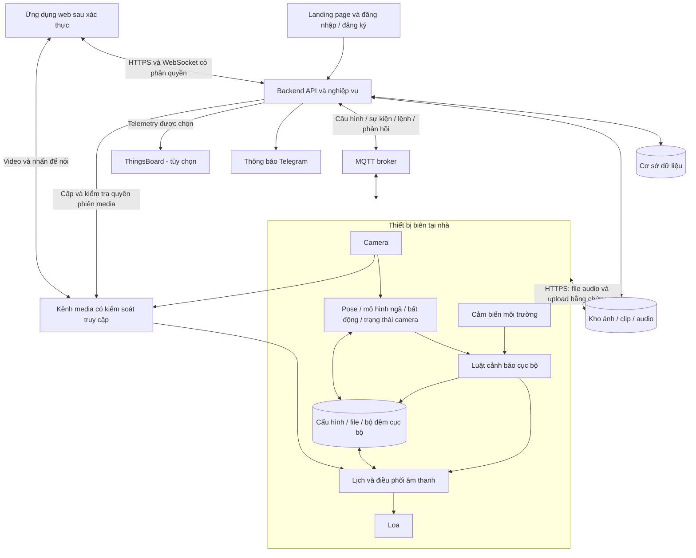
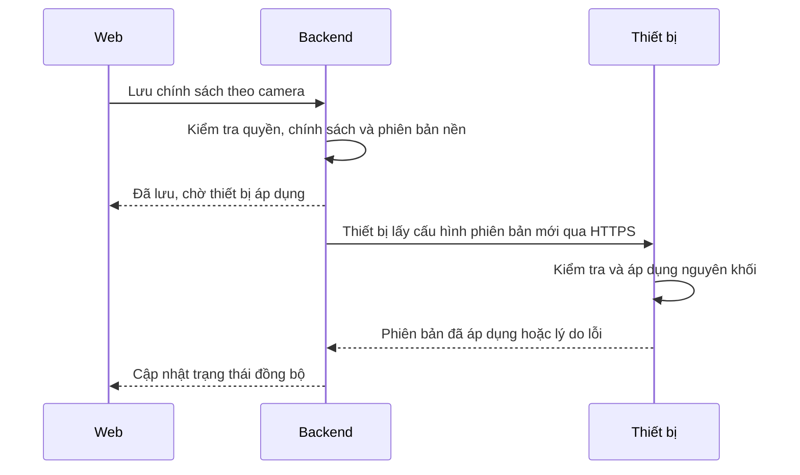

# KIẾN TRÚC HỆ THỐNG CAMERA GIÁM SÁT GIA ĐÌNH

- **Dự án:** FALL-DETECT-AIOT-SYSTEM.
- **Phiên bản:** 2.1 — ngày 29/10/2026.
- **Tài liệu nghiệp vụ:** [PROJECT_SPECIFICATION.md](PROJECT_SPECIFICATION.md).
- **Phạm vi:** Kiến trúc mục tiêu cho camera, cảnh báo an toàn, môi trường và hỗ trợ sinh hoạt. Phần hiện trạng bên dưới được đối chiếu mã nguồn; các phần còn lại là thiết kế cần triển khai, không phải xác nhận hệ thống đang hoạt động đầy đủ.

**Cập nhật phạm vi 29/10/2026:** Tạm bỏ khoanh vùng và luật dựa trên vùng; định hướng camera servo bám một người. Panorama/ánh xạ vùng chỉ xem xét sau khi tracking ổn định. UI/API chỉnh vùng và quyền sửa vùng đã được gỡ. Backend giữ lịch sử và gửi revision vùng rỗng cho thiết bị; servo chưa được triển khai/kiểm chứng.

Thiết kế dữ liệu cloud đích và kế hoạch chuyển đổi: [DATABASE_DESIGN_NEON.md](DATABASE_DESIGN_NEON.md). Backend hiện tại vẫn dùng SQLite; tài liệu này không xác nhận đã triển khai Neon/Cloudinary.

## 1. HIỆN TRẠNG TRIỂN KHAI

| Thành phần | Đã triển khai trong nguồn | Giới hạn kiểm chứng/tích hợp |
| :--- | :--- | :--- |
| [Backend nghiệp vụ](../backend/src/api.py) | Auth/email/session/CSRF, nhà/phòng, quyền theo camera, lời mời, ghép nối, cấu hình phiên bản (vùng đã tạm bỏ), sự kiện và xử lý, telemetry, lịch/lệnh, file và audit | Chưa chứng minh tất cả trên phần cứng Pi/cảm biến/loa thật |
| [Lưu trữ](../backend/src/db.py) | SQLite có transaction/FK, metadata, queue bền vững, file trên volume; giữ nguyên bảng alerts legacy nếu có | Legacy alerts chưa gắn sở hữu không được công khai qua API mới |
| [Worker nghiệp vụ](../backend/src/services.py) | SMTP retry, TTS tiếng Việt eSpeak NG, Telegram theo cấu hình, retention, luật môi trường hold/hysteresis | Telegram thực cần bot/người nhận; lịch offline cần scheduler tại thiết bị |
| [Media](../backend/src/media.py) | Relay JPEG khoảng 5 FPS và audio một chiều có session/device auth, giới hạn kích thước/thời gian, thu hồi quyền | Cần thiết bị gửi JPEG hoặc giải mã/phát WebM/Ogg; chưa phải WebRTC/NVR |
| [Frontend](../frontend/src/App.jsx) | Landing/font/CSS từ ZIP; các trang nghiệp vụ dùng API thật; phân biệt file sẵn sàng với thiết bị áp dụng/thực thi | Không dùng ảnh minh họa hoặc timer giả làm phản hồi thiết bị |
| [AI tại biên](../fall_detect/detect.py) | Pose/chuỗi TFLite, MQTT ngã/bất động; thêm credential và UUID trong payload | Luật bất động vẫn so sánh vector, chưa tiêu thụ vùng; mất pose có thể tạo vector zero. Không coi cảnh báo theo ngữ cảnh đã chạy đầu-cuối |
| [Docker](../compose.yaml) | nginx/frontend, backend, MQTT và Mailpit; named volumes; web 8188, hộp thư 8125 | Không publish broker/backend; kết nối Pi LAN cần cấu hình truy cập an toàn riêng |

Hợp đồng AI đang thấy trong nguồn là `(1, 30, 51)`, 17 khớp được chọn từ pose, sắp theo `SORTED_YOUR_KEYPOINT_NAMES`; mỗi khớp gồm x, y, visibility trước chuẩn hóa. Ngưỡng/mặc định nằm trong config và có thể bị env ghi đè. Đợt triển khai backend không thay mô hình, tiền xử lý, ngưỡng hoặc xác nhận chất lượng AI trên Pi.

```text
Web AnNhà :8188 → nginx → FastAPI nghiệp vụ → SQLite/media trên volume
                            ├─ MQTT gateway có device credential
                            ├─ SMTP → Mailpit :8125 (thử cục bộ)
                            ├─ Worker TTS / Telegram / retention
                            └─ WebSocket sự kiện / JPEG / audio có quyền

Thiết bị → /api/device/* và WebSocket media → backend
         ← cấu hình / file / lệnh; thiết bị phản hồi thực thi
```

Đọc [README](../README.md) để chạy và [DEVICE_API.md](DEVICE_API.md) để tích hợp thiết bị. Vite phát triển dùng 5188, backend phát triển 8018, không dùng cổng 5173. Các phần tiếp theo vẫn mô tả kiến trúc mục tiêu; chỉ phần đã nêu ở đây được coi là hiện trạng nguồn.

## 2. NGUYÊN TẮC KIẾN TRÚC MỤC TIÊU

1. Backend là nguồn quản lý chính cho tài khoản, nhà, quyền, cấu hình mong muốn, lịch nhắc và xử lý sự kiện.
2. Thiết bị thực thi cấu hình hợp lệ đã áp dụng gần nhất; cảnh báo tại chỗ không phụ thuộc việc mở web hoặc kết nối Internet.
3. Phân biệt luồng điều khiển/telemetry với luồng video, ảnh và âm thanh.
4. Phân biệt trạng thái quan sát của AI với trạng thái xử lý của người nhà.
5. Kiểm tra quyền theo nhà và camera ở backend, WebSocket, media và lệnh thiết bị; không chỉ ẩn nút trên giao diện.
6. Không áp dụng đa giác vùng cố định khi camera quay. Tracking cần phân biệt chuyển động người/camera; thiếu ngữ cảnh vị trí không được tự coi ít chuyển động là sự cố khẩn cấp.
7. Không thay đổi hợp đồng mô hình/tiền xử lý khi mở rộng nghiệp vụ nếu chưa kiểm chứng tương thích artifact.
8. Triển khai ban đầu bằng backend dạng một ứng dụng có các module rõ trách nhiệm; sơ đồ không yêu cầu tách thành nhiều microservice.

## 3. SƠ ĐỒ TỔNG THỂ



Kênh media và kho file là các vai trò logic. Công nghệ và cách triển khai cụ thể được chốt ở thiết kế kỹ thuật; không mặc định truyền video qua MQTT hoặc yêu cầu Pi mở cổng truy cập công khai.

## 4. TÀI KHOẢN, NHÀ VÀ ĐĂNG KÝ THIẾT BỊ

### 4.1. Mô hình sở hữu và quyền

```text
Tài khoản ── Thành viên + vai trò + phạm vi quyền ── Nhà / cụm camera
                                                       └─ Phòng
                                                           ├─ Camera / thiết bị biên
                                                           └─ Cảm biến / loa liên kết
```

- Một tài khoản có thể sở hữu hoặc tham gia nhiều nhà; một nhà chứa nhiều phòng và thiết bị.
- “Nhà” trên giao diện là đơn vị quản lý một cụm camera, không phải nhóm camera công khai có thể truy cập bằng cách biết ID.
- Thiết bị được đăng ký vào một nhà tại một thời điểm; cảm biến/loa được liên kết với thiết bị hoặc phòng để định tuyến dữ liệu và lệnh.
- Vai trò: chủ hộ, người chăm sóc và người xem. Quyền gồm xem camera/media, nhận và xử lý sự kiện, phát loa, sửa chính sách/lịch và quản lý thành viên/thiết bị.
- Không đồng nhất tài khoản người xem với danh tính người xuất hiện trong video; nhận diện danh tính nằm ngoài phạm vi đầu.

### 4.2. Luồng truy cập

1. Người dùng đăng ký, xác minh email hoặc đăng nhập; có luồng quên/đặt lại mật khẩu.
2. Backend lấy danh sách nhà từ tư cách thành viên hợp lệ. Chưa có nhà thì tạo mới hoặc nhận lời mời; có nhiều nhà thì chọn nhà.
3. Mọi truy vấn kiểm tra tài nguyên có thuộc nhà và phạm vi quyền của người dùng hay không, bao gồm ảnh/clip và sự kiện cũ.
4. Lời mời có hạn, gắn người nhận và quyền cụ thể. Chấp nhận lời mời không cấp quyền ngoài phạm vi chủ hộ đã chọn.
5. Khi thu hồi quyền, chặn API mới và kết thúc quyền nhận WebSocket/media hiện có. Quyền phiên/file tạm thời có hạn ngắn và cơ chế thu hồi phù hợp.

### 4.3. Ghép nối thiết bị

- Chủ hộ hoặc người được phép nhập mã ghép nối/QR còn hạn để đăng ký thiết bị vào nhà và phòng.
- Mã ghép nối chỉ dùng một lần, tách khỏi định danh công khai và thông tin xác thực dài hạn của thiết bị.
- Backend kiểm tra quyền sở hữu và không cho ghi đè thiết bị đang thuộc nhà khác chỉ bằng ID hoặc mã cũ. Chuyển chủ cần quy trình riêng có xác minh, ngoài luồng ghép nối thông thường.
- Sau ghép nối: kiểm tra hình ảnh/cảm biến/loa, khả năng tracking nếu được hỗ trợ và xác nhận thiết bị đã áp dụng cấu hình; không có bước vẽ vùng trong phạm vi mới.

## 5. TRÁCH NHIỆM CÁC MODULE

| Tầng | Module | Trách nhiệm |
| :--- | :--- | :--- |
| Thiết bị | Thu hình và sức khỏe camera | Cấp frame cho AI/media/bộ đệm; nhận biết lỗi và dữ liệu đứng/quá hạn |
| Thiết bị | Vision và ngữ cảnh | Pose, phân loại ngã, chất lượng quan sát, tư thế và bộ đếm bất động; xét trạng thái camera khi có tracking |
| Thiết bị | Tracking servo (cần triển khai) | Bám một người, giới hạn quay/tốc độ, xử lý mất dấu; cung cấp trạng thái chuyển động camera để đánh giá AI |
| Thiết bị | Cảm biến và luật môi trường | Đọc giá trị, trạng thái sẵn sàng/lỗi, ngưỡng, khoảng duy trì và hysteresis |
| Thiết bị | Điều phối âm thanh | Ưu tiên cảnh báo, chạy lịch, phát file, nhấn để nói; kết quả thực thi |
| Thiết bị | Đồng bộ và lưu cục bộ | Cấu hình hiệu lực, file audio, outbox sự kiện, upload media, chống lặp lệnh |
| Backend | Identity và nhà | Tài khoản, phiên, lời mời, thành viên, quyền và ghép nối thiết bị |
| Backend | Cấu hình và lịch | Phiên bản mong muốn, kiểm tra dữ liệu, phát xuống thiết bị, theo dõi áp dụng |
| Backend | Sự kiện và thông báo | Lưu bền vững, khử trùng, vòng đời xử lý, gửi và nhắc lại có giới hạn |
| Backend | Tài nguyên/media | Metadata file, cấp quyền upload/download và phiên live/nhấn để nói |
| Backend | Công việc nền | TTS, retry thông báo/upload, dọn dữ liệu, theo dõi heartbeat; trạng thái công việc được lưu bền vững |
| Web | UI công khai và ứng dụng | Landing, tài khoản, chọn nhà, camera, trạng thái tracking khi được hỗ trợ, sự kiện, môi trường, âm thanh và quản trị |

ThingsBoard là tùy chọn cho telemetry/biểu đồ, không là nguồn cấu hình hoặc vòng đời sự kiện thứ hai. Kiến trúc mục tiêu chuyển phân phối Telegram qua backend; thiết bị vẫn chịu trách nhiệm cảnh báo tại chỗ. Khi chuyển đổi phải tắt đường gửi Telegram trực tiếp cũ để tránh thông báo trùng.

## 6. CÁC LUỒNG NGHIỆP VỤ CHÍNH

### 6.1. Xem camera và phát giọng nói trực tiếp

1. Web yêu cầu mở camera thuộc nhà đang chọn.
2. Backend kiểm tra quyền và cấp phiên media có hạn cho đúng camera, chiều truyền và hành động.
3. Video đi qua kênh media tới web; backend tiếp tục cung cấp trạng thái/telemetry qua API hoặc WebSocket.
4. Nhấn để nói yêu cầu quyền phát loa và quyền sử dụng microphone của trình duyệt. Thiết bị chỉ nhận một nguồn audio theo bộ điều phối.
5. Khi mất kết nối, hết phiên hoặc thu hồi quyền, dừng phiên; không phát lại giọng nói cũ sau nối mạng.

Bản hiện tại dùng relay WebSocket JPEG/audio qua backend và reverse proxy có xác thực; WebRTC/TURN là phương án tối ưu sau khi có số đo. Chưa xác nhận chất lượng hoặc khả năng truy cập từ Internet trên hệ thống thật.

### 6.2. Đồng bộ chính sách và cấu hình



- Không yêu cầu đa giác vùng trong cấu hình hiện tại. Các trường tương thích luôn là `zones: []`, `reference: {}` để xóa vùng đã cache; không áp dụng vùng vào luật giám sát.
- Cập nhật đồng thời được phát hiện bằng phiên bản nền; không âm thầm ghi đè chỉnh sửa của người khác.
- Bản cấu hình lỗi giữ nguyên phiên bản hợp lệ trước đó. Thiết bị offline tiếp tục dùng bản cục bộ.
- Sự kiện ghi phiên bản thực sự đang áp dụng, không gắn phiên bản mới chỉ vì backend đã lưu.
- Khi khởi động, backend thêm revision mới nếu bản mới nhất còn vùng/ảnh tham chiếu, giữ nguyên lịch sử và applied version, ghi audit hệ thống; khởi động lại không thêm revision lặp. Thiết bị offline cần nối lại và áp dụng bản mới để xóa vùng cũ.
- Khi triển khai tracking, bổ sung cấu hình giới hạn quay, tốc độ và mất dấu sau thiết kế phần cứng/giao thức; không giả định API hiện tại đã hỗ trợ servo.

### 6.3. Té ngã, bất động và vòng đời sự kiện

1. Thiết bị phân tích chuỗi hình, tư thế, chất lượng quan sát và trạng thái camera. Chỉ tích lũy bất động khi đủ quan sát; không cộng thời gian mất dấu, vector rỗng hoặc camera quay/ảnh chưa ổn định khi chưa có bù chuyển động được kiểm chứng. Không dùng chuyển động ảnh do servo để kết luận người phục hồi.
2. Khi nghi ngờ, cấp mã sự kiện ổn định, lưu bản ghi vào outbox và giữ ảnh/bộ đệm clip trước-sau.
3. Áp dụng luật xác nhận và cảnh báo tại chỗ; gửi metadata ngay, không đợi clip tải lên. Nếu chỉ ít chuyển động và chưa đủ bằng chứng bất thường, dùng mức cần chú ý thay vì tự nâng khẩn cấp theo thời gian.
4. Backend xác thực thiết bị, suy ra nhà từ đăng ký thiết bị, khử trùng và lưu dữ liệu. Không tin `home_id` do bên gửi tự khai.
5. WebSocket chỉ gửi đến người có quyền trên camera; worker gửi Telegram theo danh sách nhận và quyền/chính sách chia sẻ media đã cấu hình.
6. Người nhà tiếp nhận, xác nhận an toàn/đã xử lý hoặc đánh dấu báo giả. Backend lưu lịch sử và phát lệnh tắt âm có hạn nếu người dùng yêu cầu riêng.
7. Thiết bị tiếp tục quan sát. Phục hồi hoặc mất quan sát cập nhật diễn biến; không tự coi là người nhà đã kết thúc sự cố.

Trạng thái xử lý: `OPEN → ACKNOWLEDGED → RESOLVED` hoặc `FALSE_ALARM`; cho phép đóng trực tiếp nếu người có quyền đã kiểm tra và ghi kết quả. Trạng thái quan sát độc lập: nghi ngờ, còn bất thường, đã phục hồi, thiếu quan sát.

Đóng sự kiện khi điều kiện vẫn bất thường không ngăn giám sát hoặc tái cảnh báo. Tiếp nhận không tự tắt cảnh báo gas đang còn điều kiện kích hoạt.

### 6.4. Môi trường

- Thiết bị đọc cảm biến theo chu kỳ, phát telemetry có đơn vị, thời gian đo và trạng thái chất lượng.
- Luật cục bộ dùng ngưỡng/khoảng duy trì/hysteresis được cấu hình. Sự cố môi trường dùng cùng quy trình lưu và xử lý sự kiện nhưng độc lập luật tư thế.
- Backend lưu dữ liệu chuỗi thời gian và cung cấp biểu đồ. Không biến dữ liệu thiếu thành số 0 hoặc nối khoảng trống như đã đo liên tục.
- Tín hiệu gas chưa hiệu chuẩn không được gắn đơn vị PPM. Loại linh kiện, ADC/mạch đọc, vị trí lắp và hiệu chuẩn là phần thiết kế phần cứng cần kiểm chứng.

### 6.5. Lịch nhắc và audio

1. Web lưu lịch cùng múi giờ, thiết bị đích, nội dung, âm lượng và chính sách trễ.
2. Backend tạo TTS hoặc nhận file, kiểm tra tài nguyên và lưu metadata. “Lịch đã lưu” khác “Thiết bị đã sẵn sàng”.
3. Thiết bị tải file qua HTTPS có quyền, kiểm tra tính toàn vẹn, lưu cục bộ và phản hồi sẵn sàng.
4. Scheduler dùng đồng hồ hợp lệ để phát lịch cục bộ. Một lần phát có định danh gồm lịch/phiên bản/thời điểm dự kiến để chống lặp sau restart.
5. Audio theo yêu cầu dùng `command_id` và hạn hiệu lực; không phát bù lệnh hết hạn khi thiết bị nối lại.
6. Ưu tiên: cảnh báo an toàn → âm thanh trực tiếp theo yêu cầu → lời nhắn/lịch nhắc. Audio bị gián đoạn được ghi nhận và xử lý theo hạn phát; không trộn nhiều nguồn cùng lúc.
7. Kết quả phản ánh đã nhận, đang phát, hoàn thành, bỏ qua hoặc lỗi; không suy ra đã uống thuốc hoặc đã xác nhận an toàn.

## 7. DỮ LIỆU, GIAO TIẾP VÀ LƯU TRỮ

### 7.1. Nhóm dữ liệu bền vững

| Nhóm | Nội dung |
| :--- | :--- |
| Identity | User, session, home, membership, invitation, quyền theo camera |
| Thiết bị | Room, device, camera, capability, đăng ký sở hữu, heartbeat |
| Cấu hình | Policy/schedule revision, phiên bản mong muốn và đã áp dụng; dữ liệu zone cũ không còn là yêu cầu triển khai |
| Sự kiện | Event, diễn biến, incident action, delivery status, metadata bằng chứng |
| Môi trường | Telemetry, đơn vị, chất lượng và thời gian đo |
| Audio | Audio asset, TTS job, download readiness, occurrence/execution, command result |
| Audit | Người thao tác, tài nguyên, thời gian và kết quả thay đổi |

Chọn cơ sở dữ liệu quan hệ cho quan hệ sở hữu/quyền, phiên bản và xử lý sự kiện. File ảnh/clip/audio nằm trong kho file riêng, DB lưu metadata. Sản phẩm DB và kho file cụ thể chưa bị ràng buộc bởi tài liệu này.

Thiết bị có lưu trữ cục bộ bền vững cho cấu hình, file sẵn sàng, outbox và kết quả lệnh gần nhất. Outbox chỉ hoàn tất sau phản hồi ứng dụng xác nhận backend đã lưu; MQTT PUBACK không thay cho xác nhận lưu nghiệp vụ.

### 7.2. Hợp đồng giao tiếp mục tiêu

| Kênh | Nội dung và quy tắc |
| :--- | :--- |
| HTTPS API | Tài khoản, nhà, thiết bị, chính sách, lịch, truy vấn/xử lý sự kiện; kiểm tra quyền ở mỗi thao tác |
| WebSocket | Cập nhật sự kiện, trạng thái và tiến độ; xác thực và lọc theo quyền, kiểm tra lại khi thay đổi thành viên |
| MQTT | Telemetry, heartbeat, cấu hình, sự kiện, lệnh và phản hồi; credential/ACL riêng cho từng thiết bị |
| HTTPS file | Upload bằng chứng, download audio/media bằng quyền có hạn; không phát tán đường dẫn công khai vĩnh viễn |
| Kênh media | Live video và audio một chiều; phiên gắn camera, quyền, thời hạn, có cơ chế kết thúc |

Các namespace MQTT mục tiêu phải tách telemetry, sự kiện, cấu hình, lệnh và phản hồi theo thiết bị. Các endpoint device đã được mô tả trong DEVICE_API.md. Topic `smartfall/alerts` giữ adapter legacy, bắt buộc device_token và suy ra nhà từ đăng ký camera; các topic cấu hình/lệnh riêng có thể bổ sung sau, hiện thiết bị lấy qua HTTPS.

Bản tin cần có `schema_version`, `message_id`, `device_id`, thời gian nguồn và dữ liệu đúng loại. Sự kiện có `event_id` và số thứ tự cập nhật; lệnh có `command_id`, hạn hiệu lực; cấu hình có revision. Backend ghi thời gian nhận, bỏ qua cập nhật cũ và không dùng thời gian nguồn làm khóa duy nhất.

### 7.3. Khôi phục và giới hạn dung lượng

- Khi mất Internet: AI, luật môi trường, cảnh báo tại chỗ và lịch/audio đã sẵn sàng tiếp tục hoạt động khi thiết bị còn nguồn.
- Backend phát hiện mất liên lạc từ heartbeat; không kết luận được mất điện hay mất mạng chỉ từ timeout.
- Khi nối lại: đồng bộ giờ, phản hồi phiên bản, gửi lại outbox có khử trùng, rồi upload media. Hiển thị sự kiện gửi bù theo thời điểm thực sự xảy ra.
- Không chuyển hàng loạt sự kiện cũ thành chuông “vừa xảy ra”; ưu tiên trạng thái bất thường còn tồn tại và trình bày rõ độ trễ đồng bộ.
- Có hạn dung lượng và thời hạn lưu riêng cho telemetry, media và log; ưu tiên metadata sự cố hơn dữ liệu định kỳ khi thiếu chỗ.
- Xóa file hết hạn không xóa lịch sử xử lý; hiển thị bằng chứng đã hết hạn hoặc thiếu vì lỗi.

## 8. BẢO MẬT VÀ TRIỂN KHAI

- Landing và các bước tài khoản là vùng công khai; ứng dụng, API nghiệp vụ, media và lệnh loa yêu cầu xác thực/quyền phù hợp.
- Tài khoản thiết bị tách khỏi tài khoản người dùng; broker hạn chế đúng namespace thiết bị. Không gửi credential MQTT hoặc token dài hạn xuống frontend.
- Kết nối qua Internet được mã hóa; không đưa Pi hoặc URL camera không bảo vệ ra Internet.
- Giới hạn tần suất đăng nhập, mã ghép nối/lời mời và lệnh phát loa; bảo vệ phiên và các thao tác thay đổi dữ liệu.
- Telegram chỉ nhận thông tin được chủ hộ cho phép; gửi ảnh là lựa chọn riêng, không mặc định bật.
- Log không chứa mật khẩu, token hoặc URL truy cập riêng tư có thể dùng lại.
- Dịch vụ thiết bị có cơ chế tự khởi động/phục hồi; backend, broker, DB và kho file có kiểm tra sức khỏe và sao lưu phù hợp.
- Phân tách môi trường phát triển/triển khai; endpoint mock không được mở không kiểm soát trong môi trường sử dụng thực tế.

## 9. THỨ TỰ TRIỂN KHAI VÀ CÁC QUYẾT ĐỊNH CÒN LẠI

### 9.1. Thứ tự

1. Identity, nhà/phòng, ghép nối, quyền và lưu trữ bền vững; giữ adapter cho dữ liệu AI hiện tại.
2. Live camera, chất lượng quan sát, cấu hình phiên bản và thử nghiệm servo bám một người; tạm bỏ editor vùng.
3. Bất động có xét tư thế/chuyển động camera, vòng đời sự kiện, bằng chứng và cảnh báo có phân quyền.
4. Cảm biến, Telegram, outbox offline, TTS/lịch nhắc và lời nhắn thoại.
5. Nhấn để nói, điều phối loa, kiểm tra truy cập từ xa và đo hệ thống dài giờ.

### 9.2. Cần chốt bằng thiết kế/đo thực tế

- Pi, camera, loa, cảm biến, mạch đọc và vị trí lắp cụ thể; servo, số trục, phản hồi góc, giới hạn quay/tốc độ và chính sách mất dấu.
- Đánh giá AI khi camera quay; panorama/ánh xạ vùng chưa thuộc phạm vi, điều kiện đưa lại theo mục 9.5 của specification.
- Công nghệ media, signaling và phương án relay khi truy cập ngoài mạng nhà.
- DB, kho file, công cụ TTS và cách triển khai tác vụ nền.
- Schema/topic/API chi tiết và kế hoạch chuyển đổi payload hiện tại.
- Thời gian chờ cảnh báo, FPS, độ trễ, ngưỡng chất lượng AI và dung lượng/thời hạn lưu.

Phần hiện trạng đã được cập nhật theo backend nghiệp vụ và giao diện dùng API thật; các mục tiêu edge và kiểm chứng phần cứng còn lại không được coi là đã hoàn thành. Kiểm chứng theo [các kịch bản nghiệm thu trong specification](PROJECT_SPECIFICATION.md#7-kịch-bản-nghiệm-thu-nghiệp-vụ), có phân biệt kiểm tra nguồn, mô phỏng và chạy thiết bị thật.
