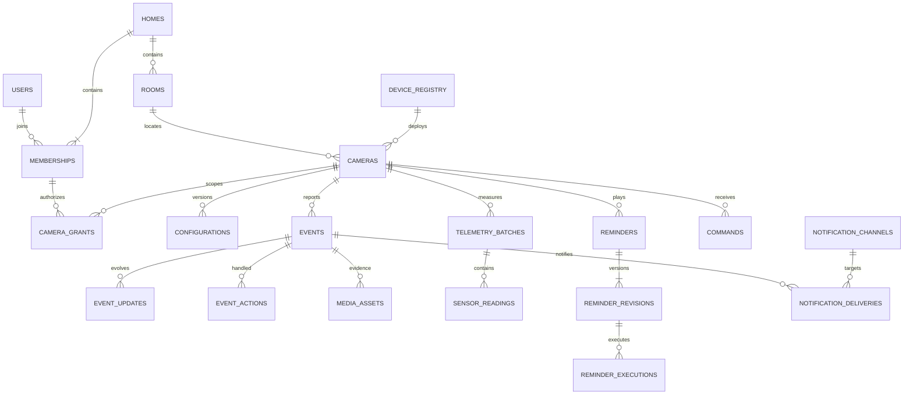

# Thiết kế database và hướng dẫn triển khai AnNhà: Neon, Cloudinary, Docker

Phiên bản 1.3 — 29/10/2026. Thiết kế theo [đặc tả hiện hành](PROJECT_SPECIFICATION.md). **Backend đã tích hợp Neon PostgreSQL, nhập dữ liệu SQLite và seed demo; media vẫn lưu local. Cloudinary chưa được nối vào runtime.** Xem [thiết lập/vận hành hiện tại](NEON_SETUP.md) và [bằng chứng kiểm thử](NEON_INTEGRATION_REPORT.md).

**Ưu tiên hiện tại:** Neon và email/Telegram; Cloudinary để giai đoạn sau. Bắt đầu bằng [NEON_SETUP.md](NEON_SETUP.md); không cần Cloudinary credential để migrate/tích hợp Neon.

**Cách đọc:** mục 1–10 mô tả dữ liệu, bảo mật và chuyển đổi; mục 12 là Docker chạy thử; mục 13 hướng dẫn Neon; mục 14 hướng dẫn Cloudinary; mục 15 giải thích `.env.example` và lỗi thường gặp. Mục 16 ghi kết quả kiểm chứng cuối.

## 1. Phương án đề xuất

- **Neon/PostgreSQL:** tài khoản, quyền, nhà/phòng, đăng ký thiết bị, phiên bản cấu hình, sự kiện, số đo, metadata media, lịch/audio, lệnh, hàng đợi và audit.
- **Cloudinary:** ảnh chụp, clip ngắn quanh sự kiện, file ghi âm và TTS; mọi media gia đình dùng chế độ bảo vệ. Không đặt video/base64 trong PostgreSQL.
- **Thiết bị:** AI, cảnh báo tại chỗ, lịch/file đã đồng bộ, bộ đệm khi offline. Cloud DB không thay thế outbox cục bộ trên Pi.
- **Backend:** xác thực và kiểm tra quyền; trung gian cấp quyền media, điều phối worker; frontend và Pi không nhận database URL hoặc Cloudinary secret.
- Không có bảng khoanh vùng. `zones: []`/`reference: {}` chỉ là trường tương thích trong cấu hình. Tracking servo chưa triển khai; sau này thêm capability/cấu hình có phiên bản, không ghi vị trí servo theo từng frame vào DB mặc định.
- Giữ email/mật khẩu/session đang dùng; chưa yêu cầu thay bằng Neon Auth hay dịch vụ đăng nhập khác.

File triển khai:

| File | Mục đích |
|---|---|
| [001_schema.sql](../backend/database/postgresql/001_schema.sql) | Bảng, kiểu dữ liệu, khoá ngoại, chỉ mục, ràng buộc và trigger |
| [002_security.sql](../backend/database/postgresql/002_security.sql) | Bốn nhóm quyền, RLS và giới hạn thao tác |
| [003_verify.sql](../backend/database/postgresql/003_verify.sql) | 46 kiểm tra nền, kết thúc bằng ROLLBACK |
| [005_email_notifications.sql](../backend/database/postgresql/005_email_notifications.sql) | Nâng cấp cảnh báo email và vòng đời địa chỉ nhận |
| [006_verify_email.sql](../backend/database/postgresql/006_verify_email.sql) | 27 kiểm tra email bổ sung, kết thúc bằng ROLLBACK |
| [README database](../backend/database/postgresql/README.md) | Cách áp dụng và chạy kiểm tra |

Không chạy DDL này trực tiếp lên database đang có bảng cùng tên. Đây không phải bản dịch từng câu SQL SQLite và không có seed xoá dữ liệu.

## 2. Mô hình quan hệ



`CAMERAS` là một lần triển khai thiết bị vào nhà, không phải serial phần cứng. Một thiết bị vật lý có thể có nhiều lần triển khai theo thời gian, nhưng chỉ một lần còn hoạt động. Hình vẽ thể hiện các quan hệ chính; DDL là nguồn đầy đủ cho khoá và tên schema.

## 3. Quy ước lưu dữ liệu

- ID nghiệp vụ dùng `uuid`; ID nguồn do Pi gửi là chuỗi riêng, không thay ID nội bộ.
- Thời điểm dùng `timestamptz`; ứng dụng trao đổi ISO 8601 có timezone. Giờ nhắc dùng `time` + IANA timezone + ngày lặp/ngày một lần. Không lưu thời điểm dưới dạng chuỗi hoặc phụ thuộc timezone máy chạy.
- Trạng thái hữu hạn dùng `text` + `CHECK`, dễ thay đổi có migration. Số đo dùng số hữu hạn và đơn vị rõ ràng; lỗi/đang khởi động không biến thành giá trị 0 hợp lệ.
- JSONB chỉ dùng cho cấu hình có phiên bản, payload bằng chứng/diễn biến và metadata mở rộng. Quyền camera, thành viên, người nhận, số đo và các quan hệ được chuẩn hoá thành hàng riêng.
- Mọi tài nguyên thuộc nhà mang `home_id`. Khoá ngoại ghép kiểm tra đồng thời nhà/camera/đối tượng liên quan; UUID ngẫu nhiên không thay cho phân quyền.
- Tài khoản, lịch và camera ưu tiên ngừng hoạt động/xoá mềm để giữ tham chiếu lịch sử. Media có trạng thái xoá riêng; không coi xoá metadata là đã xoá file trên cloud.

## 4. Từ điển bảng và nội dung cần giữ

### 4.1. Danh tính và điều khiển quyền — schema `annha_private`

| Bảng | Nội dung và ràng buộc quan trọng |
|---|---|
| `users` | Email chuẩn hoá duy nhất, tên, hash mật khẩu có thông số thuật toán, thời điểm xác minh, phiên bản xác thực, vô hiệu/xoá mềm |
| `sessions` | SHA-256 token ngẫu nhiên, hash CSRF, user, phiên bản xác thực, hạn dùng, thu hồi, lần dùng gần nhất; không lưu raw cookie |
| `email_tokens` | Hash token xác minh/reset, user, phiên bản địa chỉ email, hạn và thời điểm đã dùng; đổi email vô hiệu token/phiên cũ |
| `rate_limits` | Hash khoá giới hạn, số lần và cửa sổ; không lưu IP/email thô chỉ để rate limit |
| `security_events` | Nhật ký xác thực toàn hệ thống: đăng nhập/reset/thu hồi thành công hoặc bị từ chối, user nếu có, hash chủ thể và request ID; dùng cả khi chưa có nhà, auth không được sửa/xoá |
| `home_memberships` | User–nhà, owner/caregiver/viewer, người cấp, thời điểm thu hồi và phiên bản quyền; mỗi nhà có đúng một owner còn hiệu lực |
| `camera_grants` | Phạm vi từng camera và quyền xem/xử lý sự kiện/phát loa/sửa lịch; viewer không nhận quyền điều khiển dù dữ liệu cũ có cờ true |
| `invitations` | Nhà, email đích, vai trò, hash token, người mời/chấp nhận, hạn, trạng thái; một lời mời pending cho mỗi email/nhà |
| `invitation_camera_grants` | Phạm vi và quyền dự kiến của lời mời; camera phải cùng nhà |
| `device_registry` | Thiết bị vật lý, serial/model, ngừng sử dụng; không mang lịch sử của riêng một chủ hộ |
| `device_credentials` | Hash token thiết bị, thiết bị vật lý, camera triển khai, hạn/thu hồi; không trả token cho frontend |
| `pairing_codes` | Hash mã ghép nối, thiết bị, hạn và lần claim; cùng thiết bị với camera được nhận |
| `notification_secrets` | Đích Telegram mã hoá có `key_id`; khoá giải mã nằm ngoài DB |
| `job_queue` | Email/TTS/upload/xoá/thông báo/retention/compile config; idempotency key, lease, retry, lỗi đã lọc; nội dung chứa token/PII dùng ciphertext |
| `legacy_records` | Lưu bản ghi cũ không còn nghiệp vụ hoặc chưa ánh xạ được, gồm cấu hình vùng; không có API công khai |

Private schema được chặn bằng GRANT, không có policy cho người dùng cuối. Auth service là thành phần tin cậy có quyền cao trên nhóm này; không được biến nó thành API truy vấn tổng quát.

### 4.2. Nhà, camera và cấu hình — schema `annha`

| Bảng | Nội dung và ràng buộc quan trọng |
|---|---|
| `homes` | Tên nhà, timezone, người tạo, lưu trữ/archived |
| `rooms` | Phòng thuộc một nhà, tên và archived; không yêu cầu toạ độ/vùng |
| `cameras` | Nhà/phòng, thiết bị vật lý, tên, capability, trạng thái quan sát, heartbeat, thời điểm gỡ; không đổi `home_id`/`device_id` sau khi tạo |
| `home_settings` | Retention riêng media/telemetry/sự kiện; ngưỡng môi trường, đơn vị gas, hold/hysteresis; không tự xem số mặc định là đã hiệu chuẩn |
| `camera_configurations` | Revision bất biến; payload thực thi gồm lịch/chính sách, không cho đa giác vùng hoạt động |
| `camera_config_state` | Desired/applied version, lỗi và thời điểm áp dụng; applied tham chiếu revision có thật và không vượt desired |
| `config_acknowledgements` | Bản tin ACK theo message ID, version, success/error; retry không tạo bản ghi lặp |
| `home_storage` | Hạn mức, byte đã dùng và đã giữ chỗ; không cho tổng vượt quota |

Tạo nhà, membership owner và dữ liệu mặc định trong cùng giao dịch; trigger kiểm tra owner ở cuối giao dịch. Chuyển owner phải hạ owner cũ và cấp owner mới trước COMMIT. Khi đổi chủ thiết bị: thu hồi credential, kết thúc live session, ngừng lệnh/lịch cũ, retire camera cũ và tạo camera mới. Dữ liệu cũ tiếp tục thuộc nhà cũ.

### 4.3. Sự kiện, môi trường và nhật ký

| Bảng | Nội dung và ràng buộc quan trọng |
|---|---|
| `events` | Camera/nhà, source ID ổn định, sequence mới nhất, loại/mức độ, trạng thái quan sát và xử lý riêng, thời gian nguồn/nhận, lý do, duration, model score, config version, hạn lưu |
| `event_updates` | Mỗi sequence và payload quan sát; PK `(event_id,sequence)`; cùng nhà/camera với sự kiện |
| `event_actions` | Ai tiếp nhận/ghi chú/an toàn/báo giả/tắt âm, xác nhận còn bất thường, silence deadline và request ID chống lặp |
| `telemetry_batches` | Một message của camera, thời gian nguồn/nhận, khoá `(camera_id,message_id)` chống gửi trùng |
| `sensor_readings` | Nhiệt/ẩm/gas/light của batch; giá trị, đơn vị và quality. Gas chỉ ADC/ppm; PPM vẫn cần hiệu chuẩn bên ngoài DB |
| `monitor_states` | Trạng thái đang theo dõi của từng luật môi trường/sức khoẻ thiết bị; thời điểm bắt đầu, sự kiện đang mở, trạng thái bổ sung |
| `audit_logs` | Actor user/device/system, thao tác, đối tượng, request ID và thay đổi đã lọc; runtime không được sửa/xoá audit |

Tiếp nhận không đổi `observation` thành recovered; dữ liệu quan sát mới không tự xác nhận người nhà đã xử lý. Thời điểm camera offline là kết quả đánh giá heartbeat, không phải bằng chứng phân biệt mất điện/mạng.

### 4.4. Media, lịch nhắc, lệnh và thông báo

| Bảng | Nội dung và ràng buộc quan trọng |
|---|---|
| `media_assets` | Nhà/camera/sự kiện, loại snapshot/ảnh/clip/audio/TTS, MIME, dung lượng, checksum, thời gian ghi, trạng thái upload/xử lý/xoá, hạn lưu và định danh cloud |
| `reminders` | Lịch hiện hành: camera đích, tên, bật/tắt, current version, người tạo và xoá mềm |
| `reminder_revisions` | Giờ, timezone, weekdays hoặc once date, TTS text/audio asset, volume, late policy; asset cùng camera/nhà; không lặp ngày trùng |
| `reminder_executions` | Lần phát, version, occurrence key, giờ dự kiến/thực thi/nhận, played/failed/skipped; giữ lịch sử sau khi sửa/ngừng lịch |
| `commands` | Người gửi, camera, loại, asset, payload, idempotency key, hạn tối đa 5 phút, trạng thái thực thi và kết quả; không phát lại lệnh đã hết hạn |
| `notification_channels` | Người nhận thuộc nhà; Telegram/email; bật/tắt, loại sự cố và mức tối thiểu; email_version, suppression và quyền media; email lấy từ tài khoản đã xác minh |
| `notification_deliveries` | Sự kiện–kênh–generation; email_version, retry, accepted/delivered/bounced/complained/rejected/unknown; mỗi kênh có kết quả độc lập |
| `delivery_attempts` | Kết quả accepted/failed/unknown mỗi lần gửi, provider/account/message ID và lỗi đã lọc |
| `delivery_receipts` | Callback giao thư, bounce/complaint/rejected; chống trùng theo provider/account/event ID; ràng buộc cùng nhà/delivery/attempt; chỉ worker được ghi |
| `live_sessions` | Phiên video/nhấn để nói, user/camera, hạn, lúc đóng và lý do; không chứa frame/audio chunk; push-to-talk tối đa 60 giây |

Live stream không được upload thành ảnh từng frame lên Cloudinary. Loa chỉ có một nguồn phát tại một thời điểm; phiên truyền và khoá điều phối vẫn do media service quản lý, DB không đảm nhiệm truyền âm thanh.

## 5. Bảo mật và quyền truy cập

### 5.1. Nhóm quyền database

| Nhóm | Phạm vi | Không được làm |
|---|---|---|
| Migration owner | Tạo/cập nhật schema; bảo trì và import có kiểm soát | Không dùng credential này cho web/Pi |
| `annha_auth` | Auth, session, thành viên, lời mời, cấp/claim/thu hồi thiết bị; bootstrap nhà/phòng/camera | Không có quyền trực tiếp đọc sự kiện/media nghiệp vụ |
| `annha_app` | Truy vấn/thao tác theo user, nhà và quyền camera | Không đọc password/session/device token; không quản trị membership bằng SQL trực tiếp |
| `annha_device` | Nhận cấu hình/file và gửi dữ liệu cho camera đã xác thực | Không chọn nhà/camera khác, không ghi trạng thái xử lý của người nhà |
| `annha_worker` | Tác vụ nền; một tenant context mỗi giao dịch nghiệp vụ | Không đọc bảng mật khẩu/session/credential; không sửa revision/audit đã lưu |

Đây là các nhóm NOLOGIN. Mỗi thành phần backend dùng login riêng chỉ được cấp đúng một nhóm; không cấp nhóm worker/auth cho login app/device. Trong monolith vẫn cần connection pool riêng theo trách nhiệm; việc chia role không tự tạo ra microservice.

RLS được bật và FORCE trên tất cả bảng nghiệp vụ. Có policy bảo trì rõ ràng cho migration owner. Helper kiểm tra membership/grant dùng `SECURITY DEFINER`, tên đối tượng đầy đủ, `search_path=pg_catalog` và thu hồi EXECUTE mặc định của PUBLIC. PostgreSQL phân biệt quyền bảng và policy theo hàng; owner/BYPASSRLS có đặc quyền, do đó runtime không được sở hữu bảng hoặc có BYPASSRLS. [PostgreSQL RLS](https://www.postgresql.org/docs/16/ddl-rowsecurity.html), [function security](https://www.postgresql.org/docs/16/sql-createfunction.html).

### 5.2. Truyền context trong mỗi giao dịch

Backend xác thực session/credential trước, sau đó đặt context từ kết quả xác thực, không lấy user ID/home ID/camera ID tuỳ ý từ request:

```sql
BEGIN;
SET LOCAL ROLE annha_app;
SELECT set_config('app.user_id', $1, true);
SELECT set_config('app.home_id', $2, true);
-- Truy vấn có schema đầy đủ; mọi câu sau phải cùng transaction/connection.
SELECT id, kind, severity, status
FROM annha.events
ORDER BY received_at DESC, id DESC LIMIT 50;
COMMIT;
```

`$1/$2` là tham số driver trong ví dụ, không phải cú pháp biến để paste trực tiếp vào SQL Editor. Device transaction dùng role device và home/camera đã suy ra từ credential. Worker dùng role worker và home của job đã kiểm tra, đồng thời xoá user/camera context không cần thiết bằng `set_config(...,'',true)`.

Thiếu context bị từ chối dữ liệu. RLS còn kiểm tra membership và quyền camera của user; đổi nhà trên UI không tự có quyền vào nhà đó. **Các custom setting này không phải cơ chế xác thực chống kẻ đã có DB credential/SQL injection**: backend được tin cậy khi đặt chúng. Luôn parameterize SQL, không đưa kết nối DB ra trình duyệt; RLS là lớp bổ sung.

Neon pooler dùng transaction pooling; không dựa vào SET/session state sống qua nhiều transaction. Dùng context LOCAL, truy vấn tên schema đầy đủ; migration/backup dùng direct connection. [Neon pooling](https://neon.com/docs/connect/connection-pooling).

### 5.3. Các kiểm tra vẫn thuộc backend

DDL chặn cấu trúc/quyền dữ liệu. Adapter `pg*` hiện triển khai các bước dưới đây; các phần Cloudinary/receipt được đánh dấu là giai đoạn sau:

- Hash mật khẩu bằng hàm chuyên dụng có salt/chi phí; giữ tương thích PBKDF2 hiện có, có thể nâng Argon2id khi đăng nhập thành công. Không SHA-256 trực tiếp mật khẩu; SHA-256 trong schema chỉ dành cho token ngẫu nhiên entropy cao.
- Cookie HttpOnly/Secure/SameSite, HTTPS, kiểm tra Origin và CSRF; xác minh email, hạn session, `auth_version`, thu hồi sau reset/logout. Hash CSRF khác SQLite cũ: phát lại raw CSRF đã ký hoặc xoay raw token và cập nhật hash ở `/auth/me`; không cố giải hash để trả lại.
- Auth/control-plane API phải tự kiểm tra owner, email đích của lời mời, scope camera cùng nhà, hạn/token một lần; không cho client tự khai role quản trị. Hết hạn lời mời phải chuyển trạng thái trước tạo lại để không vướng pending unique index.
- Mã ghép nối/credential phải đủ entropy; dùng transaction và UPDATE có điều kiện để một code chỉ claim một lần. Thiết bị chưa claim, retired hoặc token revoked không được xác thực; chuyển chủ không tái sử dụng credential cũ.
- Mỗi thay đổi quyền làm tăng version, ghi audit và kết thúc live/WebSocket hiện có. RLS chặn truy vấn tiếp theo, không tự đóng socket hoặc thu hồi byte media đã tải.
- Không nhận diện danh tính người trong video, không tạo bảng face embedding trong phạm vi này.
- API chuyển lỗi UNIQUE/FK/RLS thành thông báo chung, không trả SQL/detail chứa email, token hoặc tài nguyên của nhà khác.
- Đặt giới hạn body, truy vấn, thời gian statement và dung lượng file; làm sạch tên file, kiểm tra magic bytes/MIME và không dùng public ID/URL do client tự khai làm bằng chứng sở hữu.
- Log chỉ lưu mã lỗi, request ID và ID nội bộ cần thiết; không lưu cookie, token, DB URL, Cloudinary signature hoặc nội dung giọng nói tự do trong audit.

Bot token, Cloudinary API secret, khoá mã hoá và DB passwords để ở secret manager/env server. `destination_ciphertext` và nội dung email cần token dùng mã hoá xác thực ở ứng dụng (kèm nonce/tag trong envelope); `key_id` chỉ trỏ phiên bản khoá. Có quy trình xoay khoá, không để khoá trong cùng DB/backup.

## 6. Media qua Cloudinary

### 6.1. Cách bảo vệ và lưu metadata

Chọn `authenticated` để bảo vệ cả bản gốc và bản biến đổi. URL có chữ ký thông thường không tự gắn thời hạn; **đề xuất mặc định là backend proxy có kiểm tra quyền**, không redirect URL lâu dài cho browser. Nếu sau này dùng CDN token có expiry, cần xác minh gói Cloudinary hỗ trợ. [Cloudinary access control](https://cloudinary.com/documentation/control_access_to_media).

DB lưu `provider_environment` (cloud name), `provider_asset_id`, `public_id`, `resource_type`, `delivery_type`, `provider_version`, MIME, bytes, checksum và trạng thái; không lưu signed URL làm quyền truy cập lâu dài. Client chỉ nhận ID nội bộ/API media. Thiết kế public ID ngẫu nhiên như `annha/prod/<asset_uuid>`, không nhúng email/tên người/phòng. Các bản dev/staging/prod tách môi trường/prefix và credential.

Giới hạn ban đầu giữ theo ứng dụng hiện có: **25 MiB/file, 512 MiB/nhà**. Đây là quota ứng dụng, không phải quota hay bảo đảm của gói Cloudinary. Audio dùng resource type `video` của Cloudinary; xoá cũng phải chỉ định đúng resource/delivery type. [Cloudinary deletion guide](https://cloudinary.com/documentation/delete_assets).

### 6.2. Upload và hoàn tất

Luồng đề xuất ban đầu: thiết bị/browser → backend → Cloudinary. Backend giữ quyền kiểm tra nội dung và hạn mức; upload trực tiếp từ client là tối ưu sau.

1. Xác thực người/thiết bị; suy ra nhà/camera. Với bằng chứng, xác nhận event cùng camera. Với audio, kiểm tra quyền phát loa.
2. Trong transaction: giữ chỗ dung lượng, tạo `media_assets` uploading/processing bằng `upload_key` ổn định, ghi job/outbox khi cần. COMMIT trước gọi mạng.
3. Kiểm tra bytes/MIME/giới hạn trong lúc nhận; server quyết định public ID ngẫu nhiên, `overwrite=false`, type và các tham số upload, không dùng preset unsigned cho media gia đình. [Cloudinary upload authentication](https://cloudinary.com/documentation/upload_images).
4. Sau upload, xác minh kết quả phía server. Trong transaction khác: khoá asset/storage, chuyển reserved sang used, ghi metadata, đặt ready. Retry cùng upload key trả cùng asset.
5. Webhook phải xác minh chữ ký/raw body và timestamp bằng SDK; khử trùng theo asset/version/action trong queue. Không nhận JSON của browser làm bằng chứng upload thành công. [Cloudinary notification signatures](https://cloudinary.com/documentation/signatures).
6. Nếu upload thành công nhưng DB thất bại, job đối soát kiểm tra public ID/asset ID xác định trước để hoàn tất hoặc xoá file mồ côi. Upload treo cần đối soát trước khi giải phóng reservation, tránh release dung lượng trong khi file cloud đã tồn tại.

Ví dụ giữ chỗ, phải dùng cùng transaction với INSERT asset:

```sql
UPDATE annha.home_storage
SET reserved_bytes = reserved_bytes + $2, updated_at = now()
WHERE home_id = $1 AND used_bytes + reserved_bytes + $2 <= quota_bytes
RETURNING home_id;
```

Không có hàng trả về thì từ chối upload. `$2` phải là số dương đã xác minh; SQL adapter phải đếm hàng và rollback khi insert asset thất bại. Giới hạn reservation, thời hạn upload và reconciliation là trách nhiệm worker, không tự chạy bởi DDL.

### 6.3. Xem và xoá

- `GET /assets/{id}`: kiểm tra user/thiết bị, nhà/camera, trạng thái ready, chưa quá hạn/xoá; backend truy xuất object đã ánh xạ và trả bytes/Range phù hợp với `Cache-Control: private, no-store`. Không nhận URL ngoài từ request để proxy.
- Khi quyền bị thu hồi, chặn yêu cầu/Range tiếp theo, ngắt live stream đang hoạt động theo media service. Không hứa thu hồi bản người nhận đã tải hoặc ảnh đã gửi Telegram.
- Đến hạn/xoá thủ công: transaction đánh dấu deleting, chặn truy cập và ghi delete job. Worker xoá cloud, yêu cầu invalidate CDN, kiểm tra kết quả rồi mới đặt deleted/expired và giảm used bytes. Thất bại thì retry, không ghi đã xoá thành công. Invalidation có độ trễ; backup cloud cần chính sách riêng. [Cloudinary deletion](https://cloudinary.com/documentation/delete_assets), [backup/versioning](https://cloudinary.com/documentation/backups_and_version_management).
- Metadata sự kiện vẫn hiện ngay cả khi bằng chứng thất bại/hết hạn. Không chặn cảnh báo để chờ file upload.

## 7. Giao dịch, retry và các bất biến cần giữ

| Luồng | Cách thực hiện khi port backend |
|---|---|
| Event upsert | `UNIQUE(camera_id,source_id)`; tạo/lấy và khoá hàng bằng `FOR UPDATE`; không đổi kind; bỏ qua sequence cũ/trùng; insert update + cập nhật summary + enqueue notify cùng transaction |
| Xử lý sự kiện | Khoá event, xác nhận điều kiện nghiệp vụ/confirm-abnormal; append action + đổi human status + audit trong cùng transaction; không đổi observation vì bấm tiếp nhận |
| Telemetry | Insert batch bằng `ON CONFLICT DO NOTHING`; chỉ insert readings/đánh giá luật một lần khi batch mới. Số đo gửi bù được lưu nhưng không tự kích hoạt chuông “vừa xảy ra” |
| Compile cấu hình | Worker khoá camera/config state; cấp version kế tiếp, insert immutable payload, đổi desired; không tăng applied trước ACK thực |
| ACK cấu hình | Sau xác thực device, ghi ACK chống trùng; service tin cậy cập nhật applied nếu version có thật, không lùi và success; ACK lỗi giữ applied cũ |
| Sửa lịch | Insert revision và đổi current version cùng transaction; FK deferred. Lưu version trong execution để lần phát cũ không bị hiểu theo lịch mới |
| Lệnh | Insert idempotency key; retry cùng key/phần thân trả cùng kết quả, khác phần thân trả 409. Khoá hàng khi ACK, chặn chuyển trạng thái ngược và bắt đầu phát sau deadline |
| Notification | Một delivery/event/channel/generation; trước gửi kiểm tra lại membership/scope/consent, trạng thái event, số lần nhắc và channel. Telegram không có giao dịch nguyên tử với Postgres: timeout có thể cho kết quả unknown, không cam kết exactly-once ngoài DB |
| Worker jobs | Claim hàng đến hạn bằng `FOR UPDATE SKIP LOCKED`, ghi lease rồi COMMIT; gọi cloud/email ngoài giao dịch. Reclaim lease hết hạn, retry có backoff và giới hạn |
| Quota | Giữ chỗ và ghi asset nguyên tử; chuyển reservation/usage và cập nhật asset nguyên tử; định kỳ đối soát totals với Cloudinary, tránh quota âm/rò reservation |

Các cột/unique/check/RLS và orchestration PostgreSQL nằm trong DDL cùng các module `pg*`. Worker đang chạy cho mail, TTS, delivery, thiết bị offline và retention. Phần Cloudinary và provider receipt còn chờ tích hợp.

## 8. Lưu trữ, hiệu năng và vận hành

Đề xuất thời hạn khởi đầu, có thể cấu hình và cần chủ dự án chốt trước production:

| Loại | Đề xuất |
|---|---|
| Telemetry raw | 14 ngày; sau đó xoá batch/readings theo lô; có thể thêm tổng hợp theo giờ khi cần biểu đồ dài hạn |
| Ảnh/clip sự kiện | 14 ngày, hạn riêng trên mỗi asset; metadata sự kiện giữ lâu hơn |
| Snapshot không có sự kiện | Giữ tối đa 5 ảnh/camera như hiện có và áp dụng TTL ngắn; không upload từng frame live |
| Audio/TTS đang được revision còn dùng tham chiếu | Không xoá theo TTL ảnh; ngừng lịch, giữ lịch sử và xử lý file không còn dùng theo chính sách riêng |
| Sự kiện và thao tác xử lý | 365 ngày khởi đầu; xoá/ẩn danh có kế hoạch theo yêu cầu chủ hộ |
| Audit | Đề xuất 365 ngày; runtime không có DELETE, thực hiện retention bằng tác vụ bảo trì được cấp quyền riêng |
| Token/session/rate limit | Xoá theo hạn và khoảng điều tra cần thiết; nội dung email chứa token xoá sau gửi hoặc quá hạn |
| Job hoàn tất/lỗi | Có TTL riêng, giới hạn lỗi và payload; không giữ token/PII vô hạn |

Worker retention xoá dependency theo thứ tự (delivery attempts → deliveries/actions/updates → metadata sự kiện khi không còn media tham chiếu); không dùng cascade xoá toàn bộ nhà. Nếu cần giữ bản ghi pháp lý/sự cố lâu hơn thì chủ dự án chọn policy riêng trước vận hành; tài liệu không xác lập thời hạn bắt buộc pháp lý.

Các index đã có cho feed sự kiện, camera/time, pending commands, media hết hạn, queue và audit. Phân trang bằng `(received_at,id)` thay vì OFFSET lớn. Chưa phân vùng bảng ở mốc nhỏ: ví dụ 10 camera gửi mỗi 15 giây tạo khoảng 57.600 batch/ngày và 806.400 batch/14 ngày, chưa kể readings/index; cần đo dung lượng thực. Khi số lượng tăng, xem xét partition telemetry theo tháng và bảng dedupe độc lập để giữ khoá nguồn qua partition.

Chọn region Neon/Cloudinary và vị trí backend theo phép đo RTT từ môi trường triển khai. Giới hạn pool nhỏ theo số replica/worker, đặt timeout và retry ngắn có idempotency; không để một worker giữ transaction trong lúc upload video. Không dùng LISTEN/NOTIFY trên pooled connection làm cơ chế thông báo bền vững; có thể poll outbox hoặc dùng message broker khi triển khai.

Backup DB không backup file Cloudinary. Cần kiểm thử restore cả metadata và asset, kiểm tra object thiếu/mồ côi; Neon branching dùng cho thử migration nhưng bản sao dữ liệu production phải được che thông tin hoặc kiểm soát quyền. Không clone secrets/media gia đình sang môi trường công khai.

## 9. Áp dụng Neon và tách credential

Neon cấp `neon_superuser` cho role tạo qua Console/API/CLI; runtime nên tạo bằng SQL với quyền tối thiểu và kiểm tra lại membership, không chỉ xem `rolbypassrls` của riêng login. [Neon role management](https://neon.com/docs/manage/roles).

Quy trình đề xuất:

1. Tạo database/branch mới dành cho AnNhà; chọn PostgreSQL tương thích 16+ và bật kết nối TLS.
2. Dùng direct migration connection áp dụng `001_schema.sql`, `002_security.sql`, rồi `005_email_notifications.sql`. Bốn tên group phải chưa tồn tại; không tự tái sử dụng role cũ chưa kiểm tra quyền.
3. Tạo bốn login riêng bằng SQL, cấp đúng group; password đặt qua cơ chế quản lý secret, không commit vào SQL. Ví dụ một login:

```sql
CREATE ROLE annha_api_login LOGIN NOINHERIT NOSUPERUSER NOBYPASSRLS NOCREATEDB NOCREATEROLE;
GRANT annha_app TO annha_api_login;
-- Đặt password qua công cụ quản trị/psql \password; không ghi literal vào repository.
```

4. Kiểm tra login không có membership `neon_superuser` hoặc role quản trị khác, không sở hữu schema/bảng và chỉ SET ROLE được group cần dùng. Nhóm migration có policy bảo trì riêng, không cấp nó cho runtime.
5. Backend dùng pooled connection riêng theo vai trò; chạy `SET LOCAL ROLE` và context trong mỗi transaction. Driver dùng TLS xác minh hostname/CA (`sslmode=verify-full` khi hỗ trợ) theo connection string của Neon; không tắt certificate verification để “chạy được”.
6. Secrets dự kiến: `DATABASE_URL_APP`, `DATABASE_URL_AUTH`, `DATABASE_URL_DEVICE`, `DATABASE_URL_WORKER`; `DATABASE_URL_MIGRATION` chỉ có trong công cụ deploy. Cloudinary credentials và khoá mã hoá chỉ có ở service cần chúng.
7. Thử permission và restore trên branch thử trước production. Schema kiểm thử không phải dữ liệu thật; không chạy `003_verify.sql` trên production.

## 10. Chuyển từ SQLite hiện có

| Nguồn SQLite | Đích và xử lý |
|---|---|
| `users` | Giữ UUID/email/name/hash; verified → timestamp có ghi rõ nguồn; không tự bịa thời điểm xác minh lịch sử |
| `sessions`, `email_tokens` | Khuyến nghị hết hiệu lực khi cutover và yêu cầu đăng nhập/lấy link mới; không biến raw CSRF cũ thành hash rồi cố giải ngược |
| `homes`, `memberships` | Settings tách bảng; scopes/rights JSON chuyển membership + camera_grants; bỏ quyền zones; kiểm tra đúng một owner |
| `rooms`, `cameras` | Camera hiện có thành một deployment; tạo device registry/credential; rotate device token khi rollout nếu cần, không in token ra log |
| `invitations` | Chuyển scopes thành rows; khuyến nghị revoke lời mời cũ và phát mới khi đổi hợp đồng token |
| `configurations` | Revision không còn vùng → immutable config; cấu hình có vùng chuyển archive, tạo version rỗng mới; version event cũ phải ánh xạ rõ, version 0/không biết chuyển NULL; không xoá tham chiếu |
| `events`, `actions` | Giữ source ID/sequence/status/observation; summary thành events và payload hiện còn thành một event_updates; không dựng thêm update lịch sử chưa từng lưu |
| `telemetry` | Batch + các readings đã biết đơn vị/quality; không nâng ADC thành ppm |
| `assets` | Metadata + job upload file local; ready chỉ sau kiểm tra cloud. Giữ local fallback trước khi đổi provider, không xoá file gốc ngay |
| `reminders`, `executions` | Tạo revision hiện có, map occurrence và asset; giữ lịch sử không còn reminder trong legacy archive thay vì bịa quan hệ |
| `commands`, `deliveries` | Hết hạn lệnh cũ tại cutover; map kênh/người nhận/generation và số lần nhắc; không phát lại side effect cũ |
| `mail_jobs`, `rate_limits` | Di trú công việc còn hạn sang queue an toàn; không gửi lại email/token hết hạn |
| `device_health`, `environment_states`, `audit` | Map monitor states/audit; actor `system` không ép thành user UUID giả |

Adapter SQLite cũ được giữ nguyên. `src.entrypoint` chọn adapter `pg*` khi `DATABASE_BACKEND=postgres`; adapter dùng Psycopg 3, SQL PostgreSQL tham số `%s`, native UUID/timestamptz/JSONB, bốn pool và transaction-local RLS. Công cụ `scripts/cloud/deploy_postgres.py` quản lý checksum migration; `import_sqlite.py` nhập snapshot atomically và giữ nguồn nguyên vẹn.

Cutover: snapshot/backup → dừng ghi ngắn → import có mapping/đếm/checksum → kiểm tra quyền/idempotency/quan hệ → cấu hình backend mới → thử với thiết bị kiểm thử → mới mở ghi production. Tránh dual-write nếu chưa có thiết kế xử lý lệch. Giữ SQLite/media gốc chỉ đọc trong cửa sổ rollback; nếu đã có ghi mới ở Neon, rollback phải xử lý delta trước khi quay lại, không chép đè DB cũ.

## 11. Kết quả kiểm chứng và phần còn lại

Thiết kế hiện có **40 bảng: 25 nghiệp vụ và 15 nội bộ**, sau migration email 005. **73 kiểm tra SQL/bảo mật (46 nền + 27 email)** đã chạy trên PostgreSQL 16.14 Docker lab bằng fixture rollback, không dùng dữ liệu dự án. Bản nền trước đây cũng đã được kiểm tra trên cluster tạm trong `/tmp`. Kiểm tra bao gồm cách ly nhà/camera, quyền viewer/caregiver/owner, thu hồi membership, bí mật token, device scope, chống trùng, liên kết media khác nhà, quota, revision/audit và cấu hình vùng bị loại bỏ.

Đã kiểm chứng schema và API trên Neon, driver/pool trong Docker, import snapshot, quyền runtime, thu hồi socket, media local, email Mailpit và TTS. Chưa kiểm thử Cloudinary, camera/Pi thật, tải đồng thời quy mô lớn và restore diễn tập. Không suy từ kiểm thử tổng hợp sang hiệu năng phần cứng thật.


## 12. Docker có sẵn và cách chạy trên máy của bạn

### 12.1. Thành phần đã chuẩn bị

| Thành phần | Vai trò |
|---|---|
| `compose.yaml` | Web/frontend, backend PostgreSQL hoặc SQLite theo env, MQTT và Mailpit |
| `compose.database.yaml` | Project riêng `annha-db-lab`, không dùng volume của ứng dụng |
| `postgres` | PostgreSQL 16.14 lab, volume bền vững, healthcheck; không publish cổng ra máy host |
| `db-init` | Tạo schema/security/email trong một transaction; gặp schema/role tồn tại thì dừng, không reset |
| `db-check` | Chạy 73 kiểm tra SQL bằng fixture và ROLLBACK; chỉ cho đích lab local |
| `db-inspect` | Xem số bảng, RLS và thuộc tính nhóm quyền; không trả dữ liệu cá nhân |
| `neon-init` | Psql client gửi schema tới Neon thật qua direct TLS connection, chỉ chạy khi bạn gọi rõ dịch vụ |
| `neon-inspect` | Kiểm tra catalog hoặc mở console quản trị Neon |
| `cloudinary-check` | Validate cấu hình, ping, kiểm tra hoặc tạo preset bảo vệ khi bạn chọn lệnh tương ứng |

Neon và Cloudinary không chạy trong Docker. Với production dùng Neon, không cần duy trì container PostgreSQL lab. Hai Docker tool image không chứa secret; các file được mount lúc chạy, filesystem của công cụ là read-only và không mount Docker socket.

### 12.2. Chuẩn bị lần đầu

Cài Docker Desktop/Engine kèm Compose, Python 3 cho script tạo file. Chạy lệnh từ thư mục gốc repository. Windows có thể dùng `py -3` thay `python3`.

```bash
python3 scripts/cloud/prepare_secrets.py
docker compose -f compose.database.yaml config --quiet
docker compose -f compose.database.yaml build db-init cloudinary-check
```

Script tạo `.env` nếu chưa có và các file sau, **không ghi đè file hiện hữu, không in mật khẩu**:

```text
.secrets/
  postgres_password     # mật khẩu ngẫu nhiên cho lab, đã có thể dùng ngay
  pg_service.conf       # mẫu kết nối Neon, phải điền lại
  pgpass                # mẫu mật khẩu Neon, phải điền lại
  cloudinary.env        # mẫu cấu hình Cloudinary, phải điền lại
```

`.secrets/` đã gitignore và bị loại khỏi Docker build context. Trên Unix, script tạo thư mục 0700/file 0600; với Windows hãy giới hạn ACL cho tài khoản của bạn. File mẫu `.env.example` được commit, file `.env` thật không được commit.

### 12.3. Khởi chạy PostgreSQL lab và kiểm tra schema

```bash
docker compose -f compose.database.yaml up -d --wait --wait-timeout 120 postgres
docker compose -f compose.database.yaml run --rm db-init
docker compose -f compose.database.yaml run --rm db-check
docker compose -f compose.database.yaml run --rm db-inspect
```

`db-init` chỉ chạy một lần cho database mới. Lần sau chỉ cần `up`, `db-check`, `db-inspect`; không cần init lại. Kết quả đúng: 25 bảng nghiệp vụ, 15 bảng private, tất cả 25 bảng nghiệp vụ có RLS/FORCE RLS, bốn group không LOGIN/SUPERUSER/BYPASSRLS/CREATEROLE/CREATEDB và dòng PASS ở kiểm tra.

Dữ liệu lab nằm trong volume `annha-db-lab_design-postgres`. Khi đã có dữ liệu, sửa password file không tự đổi mật khẩu trong PostgreSQL; phải đổi password role bằng quy trình quản trị rồi cập nhật file tương ứng. Không xoá volume để xử lý lỗi kết nối.

Không có cổng PostgreSQL mở ra host. Mở psql quản trị lab:

```bash
docker compose -f compose.database.yaml exec postgres psql -U annha_migration -d annha_design
```

Xem trạng thái/log và dừng mà giữ dữ liệu:

```bash
docker compose -f compose.database.yaml ps
docker compose -f compose.database.yaml logs --tail 80 postgres
docker compose -f compose.database.yaml stop postgres
```

Không dùng `down -v` để cập nhật. Lab có owner đặc quyền phục vụ kiểm tra; production dùng các login tách quyền theo mục 13.

### 12.4. Chạy stack ứng dụng hiện tại

```bash
docker compose config --quiet
docker compose up --build -d --wait --wait-timeout 120
```

Web mặc định `http://localhost:8188`, Mailpit `http://localhost:8125`. Stack chọn PostgreSQL khi `DATABASE_BACKEND=postgres`; file media vẫn local. Root `.env` hiện dùng Neon. `.env` hiện hữu được giữ; thêm các biến mới cần dùng từ `.env.example` bằng tay. Sau khi đổi env, dùng `up -d --force-recreate` để container nhận lại, không chỉ restart.

## 13. Đưa schema lên Neon từng bước

### 13.1. Tạo project/database và chọn connection

1. Đăng nhập Neon Console, tạo project dành riêng AnNhà, chọn PostgreSQL tương thích 16+ và region phù hợp backend. Đây là thao tác bạn làm trên tài khoản cloud của mình; repository không tự tạo project.
2. Chuẩn bị database mới, chẳng hạn `annha`, trên branch cần triển khai. Trước lần đầu áp schema, bảo đảm chưa có schema/group `annha_*` do một lần thử khác tạo.
3. Mở **Connect**, chọn đúng project/branch/database và migration owner. Lấy **direct host** không có `-pooler`; sau này runtime mới lấy pooled host cho từng login.
4. Lưu migration password trong `.secrets/pgpass`, các thông tin không phải mật khẩu trong `.secrets/pg_service.conf`. Không gửi URI có password qua chat, log hay commit.

Neon hỗ trợ quản lý project và chạy SQL chuẩn; đường dẫn/menu Console có thể đổi, hãy ưu tiên kiểm tra đúng project, branch và connection trong hộp Connect. [Neon getting started](https://neon.com/docs/get-started-with-neon/signing-up), [connection pooling](https://neon.com/docs/connect/connection-pooling).

### 13.2. Điền file secret cho Docker migration

`.secrets/pg_service.conf`:

```ini
[annha_neon_migration]
host=REPLACE_DIRECT_HOST.neon.tech
port=5432
dbname=annha
user=REPLACE_MIGRATION_OWNER
sslmode=verify-full
sslrootcert=/etc/ssl/certs/ca-certificates.crt
connect_timeout=10
```

Các giá trị `REPLACE_...` phải được thay bằng giá trị thật. Giữ `sslmode=verify-full`; image có CA certificates để xác minh hostname/chứng chỉ, không hạ xuống disable khi gặp lỗi TLS. [Neon TLS với psql](https://neon.com/blog/avoid-mitm-attacks-with-psql-postgres-16).

`.secrets/pgpass` gồm một dòng:

```text
REPLACE_DIRECT_HOST.neon.tech:5432:annha:REPLACE_MIGRATION_OWNER:REPLACE_PASSWORD
```

Host/database/user phải khớp file service. Với password chứa `:` hoặc `\`, escape bằng `\` theo định dạng libpq pgpass; đây không phải URL nên không URL-encode password trong pgpass. Tool copy pgpass sang file tạm 0600 trước khi gọi psql, tránh lỗi permission khi Docker mount secret.

### 13.3. Áp schema và kiểm tra

```bash
docker compose -f compose.database.yaml run --rm --no-deps neon-init
docker compose -f compose.database.yaml run --rm --no-deps neon-inspect
```

Lệnh chỉ tác động host/database trong service secret của bạn. Bootstrap gom `001_schema.sql`, `002_security.sql` và `005_email_notifications.sql` vào một transaction: lỗi một phần thì rollback; gặp schema/group đã tồn tại thì dừng. Không tự DROP, không tự reset role và không seed user mẫu. Sau thành công, không chạy init lại để “update”; các thay đổi sau dùng migration mới.

Không chạy fixture `003_verify.sql` trên database production. Nếu clone branch để kiểm tra, schema/role đã có thì chỉ inspect; không bootstrap lại. Clone phải được kiểm soát PII/secrets như mục 8.

### 13.4. Tạo login runtime và đặt mật khẩu

Mở console qua Docker, không phải cài psql trên máy:

```bash
docker compose -f compose.database.yaml run --rm --no-deps neon-inspect console
```

Trong psql, tạo login, mỗi login chỉ nhận đúng group:

```sql
CREATE ROLE annha_api_login LOGIN NOINHERIT NOSUPERUSER NOBYPASSRLS NOCREATEDB NOCREATEROLE;
CREATE ROLE annha_auth_login LOGIN NOINHERIT NOSUPERUSER NOBYPASSRLS NOCREATEDB NOCREATEROLE;
CREATE ROLE annha_device_login LOGIN NOINHERIT NOSUPERUSER NOBYPASSRLS NOCREATEDB NOCREATEROLE;
CREATE ROLE annha_worker_login LOGIN NOINHERIT NOSUPERUSER NOBYPASSRLS NOCREATEDB NOCREATEROLE;
GRANT annha_app TO annha_api_login;
GRANT annha_auth TO annha_auth_login;
GRANT annha_device TO annha_device_login;
GRANT annha_worker TO annha_worker_login;
```

Đặt mật khẩu trong lời nhắc ẩn, không ghi password literal vào file SQL:

```text
\password annha_api_login
\password annha_auth_login
\password annha_device_login
\password annha_worker_login
\q
```

Không cấp `neon_superuser` hoặc group migration cho bốn login này. Role tạo qua Console/API có thể nhận quyền quản trị; dùng SQL như trên và inspect lại membership. [Neon roles](https://neon.com/docs/manage/roles).

Lấy pooled URL riêng cho mỗi login và chuẩn bị `DATABASE_URL_APP`, `DATABASE_URL_AUTH`, `DATABASE_URL_DEVICE`, `DATABASE_URL_WORKER` trong secret manager/env của backend PostgreSQL. Password trong URL cần percent-encode. Migration URL dùng direct host và không được đưa vào runtime.

**Triển khai hiện tại:** công cụ `deploy_postgres.py` tạo bốn LOGIN NOINHERIT có quyền tối thiểu và xuất URL riêng; backend đã đọc pool/timeouts và context LOCAL. Làm theo [NEON_SETUP.md](NEON_SETUP.md) để dùng migration ledger, không chạy lại bootstrap thủ công trên database đã triển khai.

## 14. Setup và liên kết Cloudinary

### 14.1. Tạo môi trường và lưu credential

1. Tạo/đăng nhập Cloudinary và chọn product environment dùng cho AnNhà. Tách môi trường thử/production khi tài khoản hỗ trợ; không dùng chung dữ liệu gia đình thật để test.
2. Mở Settings → **API Keys**, lấy cloud name, API key và API secret của đúng environment. Chỉ lưu secret trên server; không đặt trong `VITE_*`, source React, firmware/Pi hay public upload preset. [Cloudinary API credentials](https://cloudinary.com/documentation/image_upload_api_reference).
3. Điền `.secrets/cloudinary.env` theo mẫu dưới. Không thêm dấu nháy, `export` hoặc shell expression; parser của tool đọc KEY=value đơn thuần.

```dotenv
CLOUDINARY_CLOUD_NAME=REPLACE_CLOUD_NAME
CLOUDINARY_API_KEY=REPLACE_API_KEY
CLOUDINARY_API_SECRET=REPLACE_API_SECRET
CLOUDINARY_UPLOAD_PRESET=annha_private
CLOUDINARY_DELIVERY_TYPE=authenticated
CLOUDINARY_MAX_FILE_BYTES=26214400
```

Các biến tương tự trong root `.env.example` dành cho adapter tương lai; Docker tool hiện đọc secret file nêu trên. Không cần điền hai nơi để kiểm tra cloud tool.

### 14.2. Kiểm tra và tạo signed/authenticated preset

Sau khi điền giá trị thật:

```bash
docker compose -f compose.database.yaml run --rm --no-deps cloudinary-check --validate-only
docker compose -f compose.database.yaml run --rm --no-deps cloudinary-check --ping
```

Validate-only chỉ kiểm tra cấu trúc/giới hạn cấu hình, không chứng minh credential đúng. Ping gọi Admin API đọc, xác minh credential nhưng chưa upload file hoặc xác minh toàn bộ quyền delivery.

Bạn có thể tạo preset trong Settings → Upload → Upload Presets: tên `annha_private`, **signed**, delivery `authenticated`, không overwrite file cũ và chỉ cho định dạng ứng dụng hỗ trợ. Signed preset vẫn cần server ký/khống chế tham số, không tự bảo vệ mọi upload nếu backend cho client đổi type tuỳ ý. [Cloudinary presets](https://cloudinary.com/documentation/upload_presets).

Nếu muốn tạo qua công cụ đã chuẩn bị:

```bash
docker compose -f compose.database.yaml run --rm --no-deps cloudinary-check --setup-preset
docker compose -f compose.database.yaml run --rm --no-deps cloudinary-check --check-preset
```

`--setup-preset` là **thao tác ghi cấu hình cloud**: tạo preset khi chưa có, không upload media. Nếu preset tồn tại và đã an toàn thì giữ nguyên; nếu cấu hình hiện có unsigned/public thì dừng để bạn xem lại, không âm thầm sửa. API key phải có quyền Admin phù hợp. Lệnh kiểm tra preset chỉ chứng minh signed/authenticated; giới hạn 25 MiB/file và quota nhà vẫn phải thực thi ở backend.

Danh sách định dạng preset: JPEG/PNG, MP4/WebM, MP3/WAV/Ogg. Các ảnh/thumbnail/clip cũ đã public không tự trở thành private khi tạo preset; phải xử lý riêng trước khi dùng dữ liệu thật.

### 14.3. Cách backend sẽ liên kết file với database

Luồng tích hợp cần thực hiện khi port media adapter:

```text
Pi hoặc browser
  → endpoint upload backend có xác thực
  → kiểm tra home/camera/event, MIME, size và quota
  → tạo media_assets + reservation
  → upload Cloudinary với preset, type=authenticated,
     public_id ngẫu nhiên, overwrite=false
  → xác minh phản hồi, cập nhật provider identifiers + ready
  → client nhận ID/API media nội bộ, không nhận API secret
```

Metadata phải gồm cloud name → `provider_environment`, asset ID, public ID, resource type, delivery type, version, bytes và MIME. Audio dùng resource type video. Request xem ảnh/video/audio được kiểm tra quyền và proxy theo mục 6; không đưa URL công khai vĩnh viễn vào DB/UI.

Trước production phải thử: người ngoài nhà không xem được file dù biết ID; camera khác không lấy được audio; user bị thu hồi không gửi Range mới; chữ ký biến đổi không mở quyền public; upload lỗi không trừ sai quota; delete thất bại không ghi đã xoá. URL đã ký không mặc định có TTL. [Cloudinary media security](https://cloudinary.com/documentation/control_access_to_media).

### 14.4. Webhook, TTS và xoá media

- Chuẩn bị URL HTTPS của backend cho thông báo upload/processing; `CLOUDINARY_WEBHOOK_URL` trong mẫu env là biến dự kiến. **Backend hiện chưa có route webhook Cloudinary**, vì vậy chưa đăng ký một URL giả rồi coi đã hoạt động.
- Khi bổ sung route, xác minh chữ ký/timestamp bằng SDK trên raw body, khử trùng và đối chiếu asset nội bộ; không tin callback từ browser. [Cloudinary signatures](https://cloudinary.com/documentation/signatures).
- TTS được tạo xong mới upload như audio. Pi tải file đã được cấp quyền để chạy lịch offline, không giữ Cloudinary API secret.
- Worker retention/xoá gọi API với đúng resource/delivery type, invalidate CDN và chỉ giảm quota sau xác nhận; giữ sự kiện khi file hết hạn. Thiết lập backup/cloud retention riêng, vì backup Neon không chứa media.

## 15. `.env.example` và xử lý lỗi

### 15.1. Các nhóm cấu hình

| Nhóm | Có hiệu lực ở đâu |
|---|---|
| `WEB_PORT`, `MAIL_PORT`, `PUBLIC_URL`, `APP_ORIGINS`, `COOKIE_SECURE` | Compose/ứng dụng hiện tại |
| `DATABASE_PATH`, `MEDIA_ROOT`, `MAX_HOME_MEDIA_BYTES` | SQLite/file local hiện tại; đường dẫn trong container cần nằm trên `/app/data` |
| `MQTT_*`, `WORKER_ENABLED`, `SMTP_*`, `TELEGRAM_BOT_TOKEN` | Backend hiện tại; Compose đã truyền các biến này vào container |
| `TB_*`, `DEVICE_ID` | Tuỳ chọn legacy ThingsBoard; không cần để chạy Neon/Cloudinary |
| `NEON_SERVICE_FILE`, `NEON_PGPASS_FILE`, `CLOUDINARY_CONFIG_FILE` | Đường dẫn secret file cho `compose.database.yaml`, có thể đặt ngoài repo |
| `DATABASE_BACKEND`, `DATABASE_URL_APP/AUTH/DEVICE/WORKER`, pool/timeouts | Có hiệu lực trong adapter PostgreSQL; owner URL chỉ cho công cụ triển khai |
| `DATA_ENCRYPTION_KEY*`, `SESSION_CSRF_KEY` | Bắt buộc cho PostgreSQL; mã hoá secret queue/Telegram và bảo vệ CSRF |
| `CLOUDINARY_*` | Dự kiến cho media cloud; checker dùng file secret riêng |

Root `.env.example` dùng mặc định Docker. `backend/.env.example` dùng khi chạy standalone **từ repository root**, MQTT tắt mặc định và đường dẫn lưu trữ nằm tại `backend/data`. Backend không tự đọc file này; đưa qua process manager/`uvicorn --env-file` khi phát triển.

Không commit file `.env`, `.secrets`, DB URL, bot token hay API secret. Sau khi sửa env cho Docker phải recreate container. Không dùng owner URL cho runtime, không đổi `DATABASE_PATH` thành URL PostgreSQL.

### 15.2. Lỗi thường gặp

| Lỗi | Xử lý |
|---|---|
| Docker daemon chưa chạy / permission denied socket | Mở Docker Desktop hoặc kiểm tra quyền Docker; không xoá DB để sửa |
| `role/schema already exists` khi bootstrap | Không init lại; dùng inspect, kiểm tra đúng database/project. Tạo migration mới cho cập nhật |
| Neon tool báo placeholder | Điền cả service và pgpass, đúng host/database/user; kiểm tra đường dẫn secret trong env |
| Neon auth failed | Kiểm tra đúng branch/password, pgpass escape và tên user; không in mật khẩu để debug |
| TLS/certificate verify failed | Kiểm tra direct hostname và CA; image db-tools đã cài CA. Không tắt TLS |
| Cloudinary validate thành công nhưng ping thất bại | Validate không kiểm tra credential; đối chiếu đúng cloud/environment/API key/quyền |
| Cloudinary 401/403 | Kiểm tra credential hoặc quyền Admin API; checker chỉ in HTTP code, không log secret/body |
| Preset unsigned/public | Dừng dùng cho media gia đình; kiểm tra cấu hình trong Console hoặc tạo preset tên khác rồi kiểm tra lại |
| Điền URL/preset nhưng web vẫn lưu file local | Đúng với media hiện tại: Neon đã nối nhưng Cloudinary chưa tích hợp; đọc mục 14.3 |
| DB lab healthy nhưng không kết nối được localhost:5432 | Lab không publish cổng; dùng compose exec/tool trong mạng riêng |
| Đổi password file lab rồi client không đăng nhập | File mới không tự ALTER ROLE đã init; đồng bộ mật khẩu qua console quản trị |

## 16. Kết quả Docker và việc cần hoàn tất trước cloud production

Đã thực hiện trên Docker Desktop tại máy phát triển ngày 29/10/2026:

- Build thành công `annha-db-tools:pg16` và `annha-cloudinary-tools:1`; db-tools có CA certificates để dùng TLS verify-full.
- PostgreSQL lab 16.14 đã chạy healthy; schema/security áp thành công trong một transaction, đủ 40 bảng và 25/25 bảng nghiệp vụ FORCE RLS.
- Chạy đủ 73 kiểm tra SQL/bảo mật trong container; fixture rollback. Thử bootstrap lần hai bị từ chối như thiết kế, không reset schema.
- 9 unit test Cloudinary tool đạt: validate không gọi mạng, chặn placeholder/path không an toàn/public hoặc unsigned preset; setup chỉ tạo khi thiếu, không ghi đè preset có sẵn.
- Smoke-test Docker với cấu hình giả: Cloudinary validate-only thành công, Neon placeholder bị chặn trước kết nối. Chưa dùng credential cloud thật, chưa tạo preset thật hoặc upload media.
- Script prepare chạy lại giữ nguyên nội dung `.env` và secret hiện hữu; `.secrets/` được gitignore và không vào build context.
- Frontend/backend đã rebuild và chạy healthy cùng MQTT/Mailpit, giữ volume SQLite/media. Web `http://localhost:8188`, Mailpit `http://localhost:8125`.

Phần kiểm chứng local phía trên ghi lại giai đoạn thiết kế. Sau đó Neon đã được cung cấp và tích hợp; kết quả mới tại [NEON_INTEGRATION_REPORT.md](NEON_INTEGRATION_REPORT.md). Cloudinary chưa tích hợp runtime; không suy kết quả checker thành upload/delivery cloud thành công.


## 17. Mở rộng cảnh báo email — 005

- `kind` của notification channel hỗ trợ `telegram` và `email`. Cùng một sự cố có delivery riêng cho mỗi kênh; lỗi email không ngăn Telegram và ngược lại.
- Email cảnh báo chỉ dùng địa chỉ tài khoản thành viên đã xác minh. Chưa mở địa chỉ tuỳ ý bên ngoài; không lưu lặp email plaintext trong channel hoặc receipt. Backend/worker đọc địa chỉ từ bảng users riêng tư khi gửi.
- `users.email_version`, `email_tokens.email_version` và phiên bản trên channel/delivery ràng buộc đúng địa chỉ. Đổi email tự tăng phiên bản, xoá xác minh, thu hồi token/phiên cũ, tắt kênh email và huỷ mail cảnh báo pending. Chờ xác minh email mới rồi cập nhật kênh/phiên bản trước khi bật lại.
- Channel chọn các loại `fall/immobility/environment/device`, mức tối thiểu `info/warning/critical` và bật/tắt từng kênh. Cờ suppression không cho app tự xoá; worker/auth service đã kiểm tra yêu cầu người dùng mới xử lý bỏ chặn hoặc unsubscribe.
- `can_dispatch_notification()` chỉ cho worker gọi, có tenant context; kiểm tra lại user/membership, quyền xem camera, sự kiện còn OPEN, filter, email version và suppression ngay trước gửi. Worker PostgreSQL đã gọi helper trước gửi và xử lý attempt/lease; worker SQLite cũ không dùng schema này.
- `accepted` chỉ có nghĩa SMTP/API đã nhận. `delivered` cần receipt được nhà cung cấp xác nhận, không có nghĩa người dùng đã đọc. Telegram thành công vẫn là accepted, không tự ghi delivered.
- `delivery_receipts` thêm một bảng nghiệp vụ; callback được khử trùng và buộc đúng provider/account/attempt/nhà. Backend phải xác minh chữ ký hoặc cơ chế xác thực webhook của nhà cung cấp trước khi ghi bằng role worker. Browser không được tự tạo receipt.
- Worker sẽ giảm trạng thái theo thời gian nguồn/loại receipt, không để webhook trễ tự ghi đè complaint/hard bounce thành delivered. Hard bounce/complaint: đặt suppressed + disabled cho kênh, ngừng retry; SMTP thuần chưa có receipt thì giữ accepted/unknown. Xử lý này thuộc adapter/worker cần tích hợp, không tự chạy chỉ do INSERT receipt.
- Email xác minh/reset/lời mời vẫn qua `email_tokens`/`job_queue(kind=email)` và SMTP, độc lập với tuỳ chọn cảnh báo. `EMAIL_ALERTS_ENABLED=false` không được tắt mail xác minh tài khoản.

Bản 39 bảng cũ nâng cấp một lần bằng `db-inspect upgrade-email`; bootstrap mới đã bao gồm 005. Cloudinary không phải điều kiện tiên quyết: `media_assets.provider='local'` được giữ trong đợt tích hợp Neon sắp tới.


## 18. Ánh xạ runtime đã thực hiện

| Module/công cụ | Trách nhiệm |
|---|---|
| `backend/src/entrypoint.py` | Chọn adapter theo `DATABASE_BACKEND` khi khởi động |
| `pgdb.py` | Pool theo quyền, TLS xác minh CA/host, SET LOCAL ROLE và context tenant/session/device, statement timeout; rollback/commit và trả pool tự động |
| `pgsecurity.py` | Tra session/token hash, auth_version, HMAC CSRF, membership/grant camera; thiết bị được xác định từ token registry |
| `pgapi.py` | Hợp đồng REST hiện có: tài khoản, nhà/phòng, camera, mời/quyền, event/action, telemetry, file local, lịch/version, command/ACK |
| `pgservices.py` | Compile cấu hình bất biến, ingest sự kiện idempotent/sequence, queue mã hoá, SMTP/TTS, delivery, hysteresis, offline và retention |
| `pgmain.py`, `pgmedia.py` | Lifespan, origin/headers, health kiểm tra DB, MQTT credential, WebSocket cảnh báo/ảnh/âm thanh có xác thực và kiểm tra lại quyền |
| `deploy_postgres.py` | Atomic migration/checksum, tạo LOGIN SQL hạn quyền, sinh env runtime giữ private |
| `import_sqlite.py` | Import snapshot vào DB trống; giữ hash mật khẩu/token thiết bị và local media key, không copy session thô |
| `seed_demo.py` | Fixtures DEMO có nhãn, UUID ổn định, không reset dữ liệu; 4 vai trò, 2 nhà độc lập |

Database có thêm bảng kỹ thuật `annha_private.schema_migrations` chỉ owner sử dụng. Bảng này ngoài 40 bảng ứng dụng, không được cấp cho runtime. Bốn LOGIN chỉ được SET ROLE sang group tương ứng; không có `neon_superuser`, CREATE ROLE/DB, BYPASSRLS hoặc quyền sở hữu bảng.

Luồng API kiểm tra quyền trước khi đưa home/camera vào transaction. Các thao tác thiết bị cần tổng hợp nhiều bảng (heartbeat, event summary, telemetry dedupe, config ACK, quota/media) dùng worker với tenant/camera đã xác thực; thiết bị không nhận worker credential. Pool device dùng cho đọc config/file, execution và command ACK. Pool auth là trust boundary phía server; không được cung cấp endpoint nhận SQL tùy ý.

`DATA_ENCRYPTION_KEY` là Fernet key bên ngoài DB; queue mail/TTS và đích Telegram chỉ lưu ciphertext. Token xác nhận/reset/pair/device/session dùng SHA-256; password dùng PBKDF2 với salt và 600.000 vòng. CSRF được suy ra bằng HMAC từ session token cùng khoá riêng, chỉ hash CSRF được lưu. Khoá hiện chưa có cơ chế tự động rotation/keyring nhiều khoá; rotation cần drain/re-encrypt queue và thu hồi session theo kế hoạch.

Retention hiện thực thi cho telemetry và file bằng chứng/snapshot local; giữ metadata và audit. Tự động purge event/audit, Cloudinary reconciliation/receipts, provider delivery webhook, live_session analytics và nhật ký security_events đầy đủ còn là phần mở rộng. Bảng có sẵn không đồng nghĩa mọi luồng ghi/retention của bảng đã bật.
